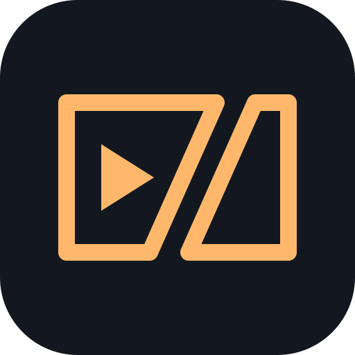
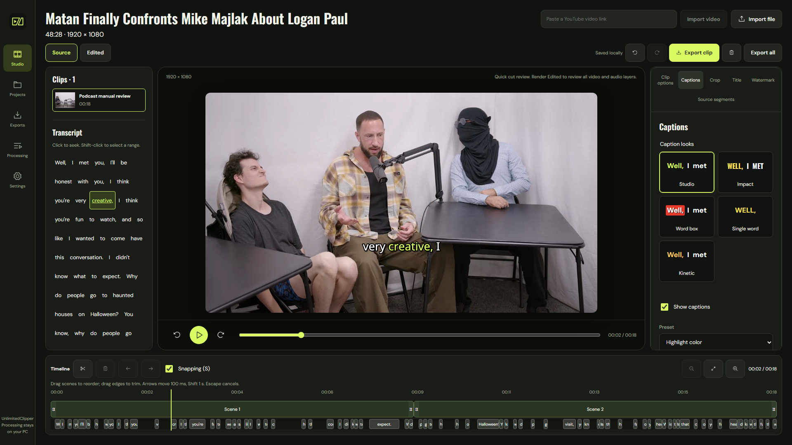
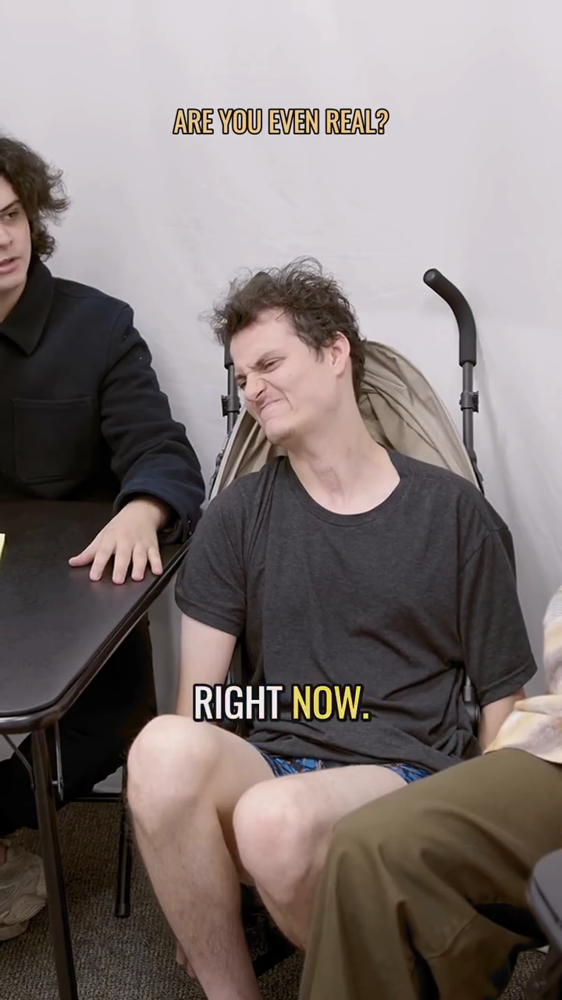
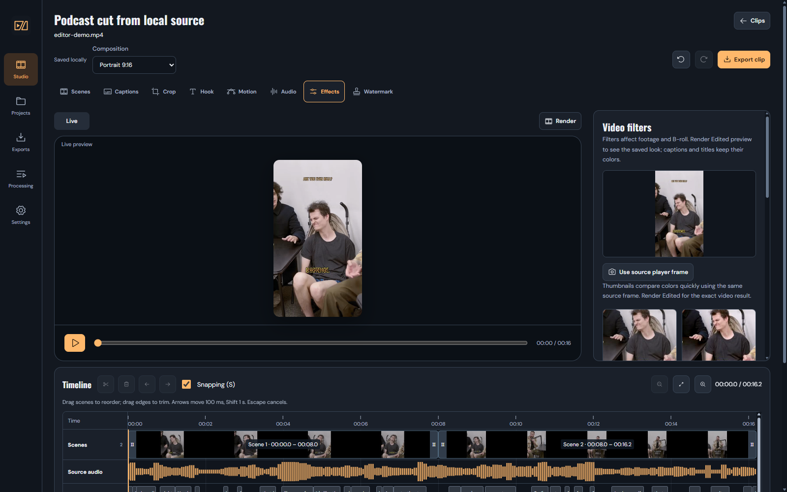
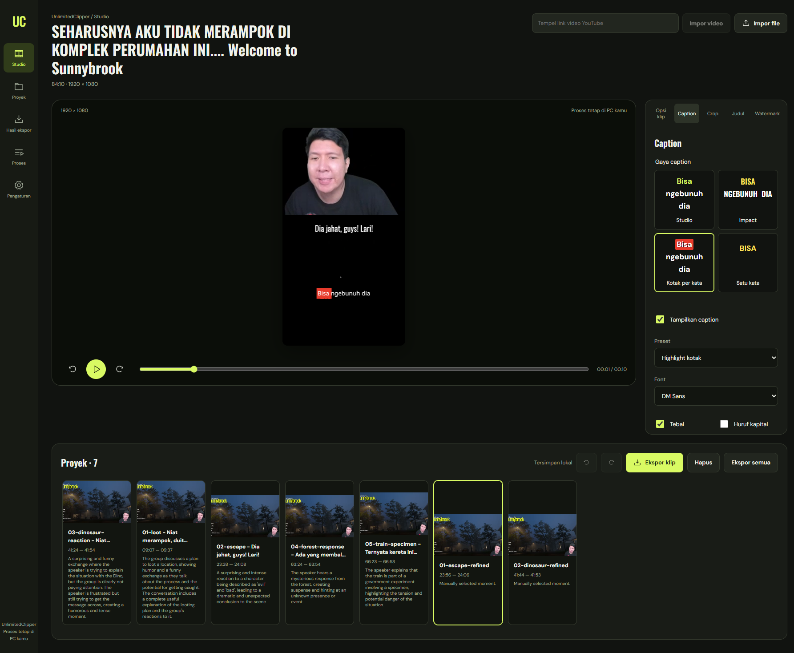
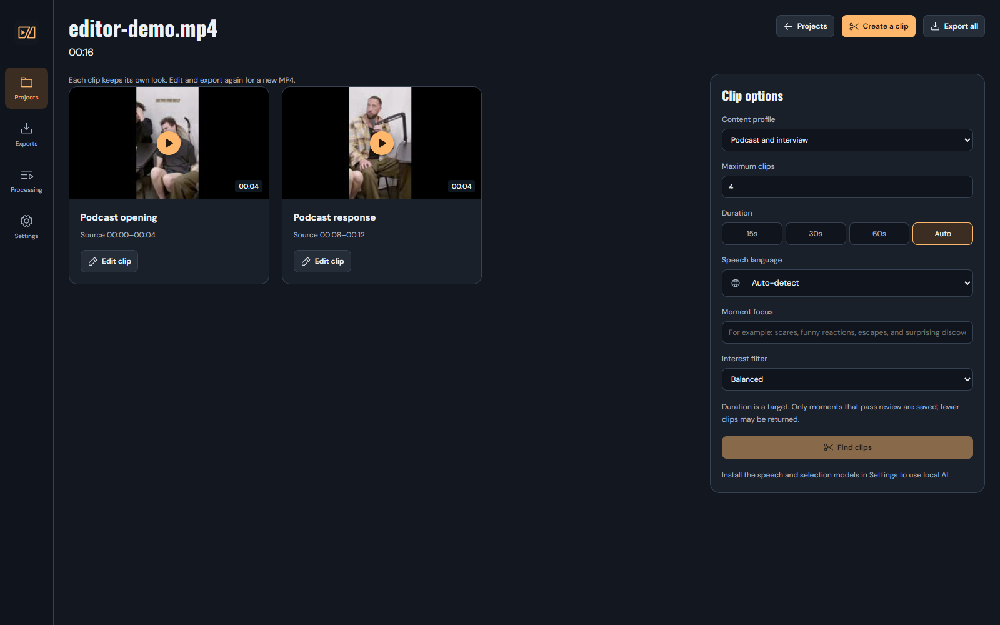
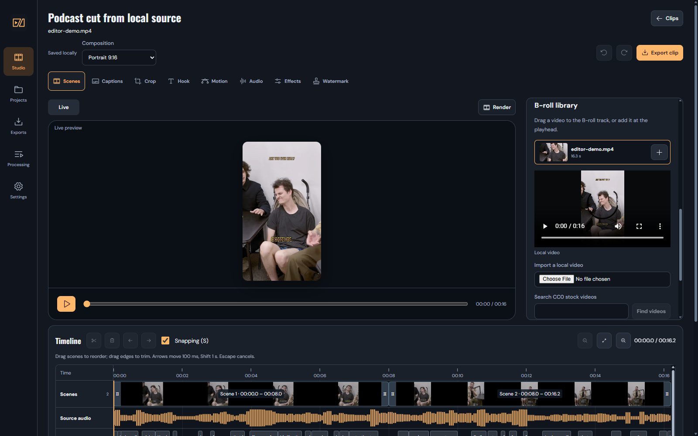
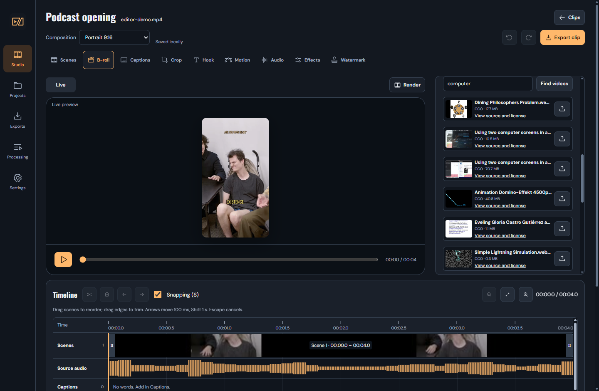
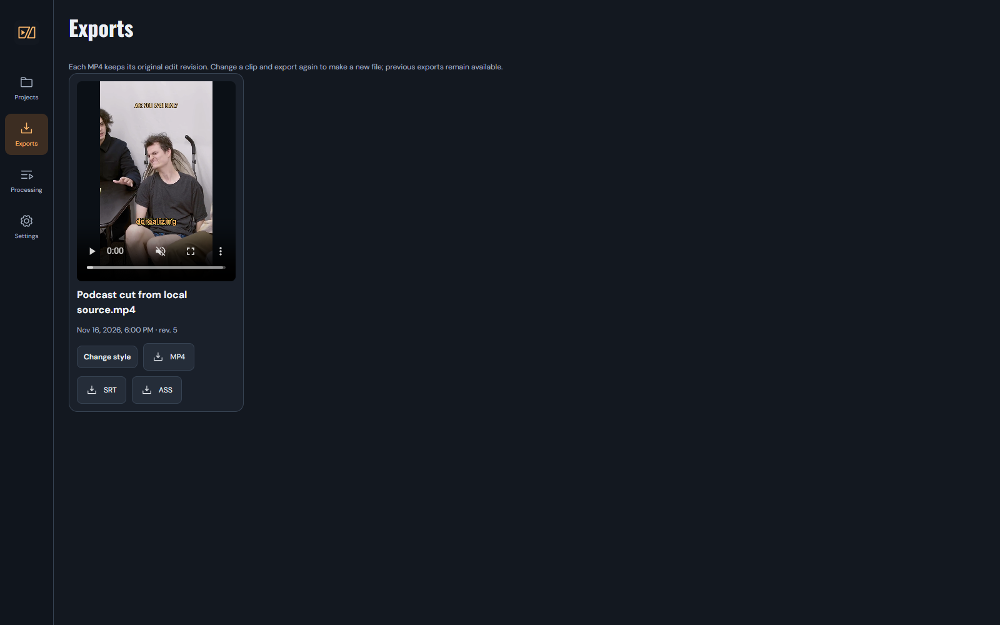
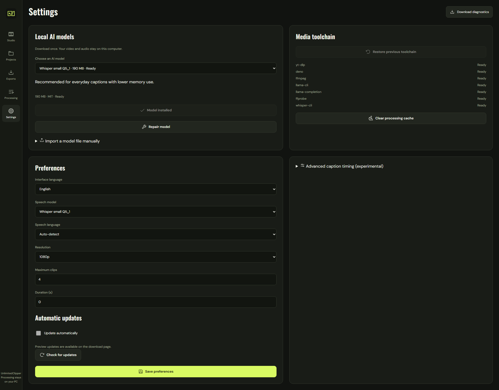

<div align="center">



# UnlimitedClipper

**Find the moment. Fix the captions. Keep the processing on your computer.**

A local video clipping studio built with Rust, React, SQLite, and Tauri.

[Clip examples](#clip-examples) · [Screenshots](#screenshots) · [Run locally](#run-locally) · [Docs](#documentation)

[Quality checks](https://github.com/bayurifkialghifari/unlimitedclipper/actions/workflows/ci.yml)

</div>

**Made for fun, still experimental.** This is a side project for tinkering with local video tools,
mostly for fun and learning, at a relaxed pace. Expect rough edges and changing features.



This Studio capture comes from the current development desktop build. The downloadable preview.8
installers below are an earlier release.

Import a long recording, find or choose a cut, review its words, and export a captioned video.
Speech recognition and clip selection run locally after the models are installed. No cloud AI
account or API key is required.

## Download the Windows preview

[Download Windows ARM64 (217 MiB)](https://github.com/bayurifkialghifari/unlimitedclipper/releases/download/v0.1.0-preview.8/UnlimitedClipper_0.1.0-preview.8_arm64-setup.exe)
for Snapdragon/ARM PCs, or
[download Windows x64 (275 MiB)](https://github.com/bayurifkialghifari/unlimitedclipper/releases/download/v0.1.0-preview.8/UnlimitedClipper_0.1.0-preview.8_x64-setup.exe)
for Intel/AMD PCs. Both belong to the same
[preview release](https://github.com/bayurifkialghifari/unlimitedclipper/releases/tag/v0.1.0-preview.8).

The repository and preview downloads are public; no GitHub account is required. Install local models
from the dropdown in Settings after installation; manual model-file import remains optional. Updater
artifacts have verified publisher signatures and SHA-256 checksums. Windows Authenticode signing
is not configured, so an unknown-publisher prompt is possible. Install/uninstall certification
and physical x64 runtime checks remain pending.

## Clip examples

**Hook, captions, color, and sound:** a real 16.26-second podcast edit rendered on the
developer's Windows ARM64 laptop. Click the frame to play the result.

<p align="center">
  <a href="docs/media/editor-demo.mp4?raw=1">
    
  </a>
</p>

[Watch MP4](docs/media/editor-demo.mp4?raw=1) · [Subtitles](docs/media/editor-demo.srt).
The 1080p export took about 34 seconds; its 720p edited preview took about 15.5 seconds on
an eight-core Snapdragon X laptop with 16 GB RAM. This reuses existing captions and excludes
transcription/discovery. The README copy is 720p. Source:
[Matan's podcast](https://www.youtube.com/watch?v=duo5XCX91YM).

Two actual exports from [Windah Basudara's Sunnybrook recording](https://www.youtube.com/watch?v=qTJIbYC2mFc).
Click a preview to open its MP4. Each example also includes a downloadable subtitle file.

<p align="center">
  <a href="docs/media/escape.mp4?raw=1">
    
  </a>
  <a href="docs/media/dinosaur.mp4?raw=1">
    
  </a>
</p>

- **Escape, 10.4 seconds:** [Watch MP4](docs/media/escape.mp4?raw=1) · [Subtitles](docs/media/escape.srt).
  A tight reaction cut with a red active-word box.
- **Dinosaur reaction, 8.7 seconds:** [Watch MP4](docs/media/dinosaur.mp4?raw=1) ·
  [Subtitles](docs/media/dinosaur.srt). Gameplay and facecam with bold yellow captions.

Both use local caption refinement, followed by manual word corrections and tighter cuts. They show
reviewed results rather than untouched automatic selections. README videos are smaller 720 × 1280
copies of the original 1080 × 1920 exports, with audio preserved.

## What you can do

| In the studio          | What it does                                                                                                                                   |
| ---------------------- | ---------------------------------------------------------------------------------------------------------------------------------------------- |
| Bring your own footage | Import a local file or download a YouTube source with yt-dlp.                                                                                  |
| Find a moment          | Choose Podcast, Gaming, Motivation, Education, or Other; set a focus and review the actual accepted/target count.                              |
| Choose your own cut    | Enter exact start/end seconds in the original recording. No AI model is required.                                                              |
| Make captions readable | Choose from 18 looks, including Reveal and Underline. Edit words and timing, customize styling, and save your own presets.                     |
| Review clip potential  | Get a local 0–100 editorial score with quoted evidence and editing suggestions. It does not predict views or virality.                         |
| Edit on the timeline   | Select transcript ranges, reorder/split/trim scenes, and review the measured source audio waveform with snapping, keyboard controls, and undo. |
| Build an editorial cut | Add text notes, punch-ins, split framing, local B-roll, and optional audio layers.                                                             |
| Review the composition | Render an edited preview from the export pipeline, then review cuts and live captions before exporting.                                        |
| Check uncertain speech | Refine an individual cut with Whisper small or medium, then seek directly to words that need review.                                           |
| Frame the clip         | Follow faces across edited scenes, add two-face split layers, or constrain a gaming facecam. Review crops and keyframes.                       |
| Shape the opening      | Edit a multiline hook with three looks, start time, duration, and Fade/Pop animation.                                                          |
| Grade the footage      | Choose five color recipes or adjust brightness, contrast, saturation, and warmth.                                                              |
| Add sound              | Audition 21 offline CC0 whooshes/clicks/taps, place them at the playhead, and edit timing/gain.                                                |
| Finish the edit        | Add an image/text watermark, with revisioned autosave and undo/redo.                                                                           |
| Export the result      | Render a single cut or a batch to MP4 with SRT and ASS sidecars. Retries keep completed exports.                                               |

The desktop window and localhost browser use the same Rust engine and saved library. The interface
supports Indonesian and English. Video files stay in managed folders; SQLite stores project data
and edit revisions.

Exports appear under **Export results** with playable MP4s and subtitle downloads. Development
saves them in `.data/exports`; an installed app uses its OS application-data directory. A custom
export folder in Settings is planned for a later update.

For a constrained PC, choose Economy in Settings: 1.7B proposes moments and installed 4B reviews
the complete candidates. Models load one at a time with a 4,096-token context. Start with
Whisper small and 720p output; use optional medium only on uncertain cuts. This reduces the
scope of expensive work but does not guarantee speed or accurate clip selection. See the
[local processing strategy](docs/research/economy-processing.md) and [actual validation](docs/validation.md).

## Screenshots

### Compare video filters

Five recipes show the same actual source frame. Capture another frame from the source player,
then fine-tune brightness, contrast, saturation, and warmth. These lightweight images approximate
the colors; render the edited preview to review the final composition. This capture uses the current
Windows ARM64 desktop development build.



### Caption editing

18 looks, the clip's subtitle text, and a preview of the active phrase. Styles, timing, and
manual corrections become part of the saved edit. The native capture uses the reviewed podcast
export and its matching subtitle sidecar in an isolated desktop library.



### Clip library and B-roll

Each clip card shows its own source frame. Select its play control to render and review the saved
edit without opening Studio; Edit clip opens the timeline. The separate B-roll tab can use the
installed local model to choose a transcript moment, search for a relevant CC0 video, import it,
and preview it before placement. Manual search, local import, and drag placement remain available.







### Export results

Completed videos appear immediately with playback controls and their MP4, SRT, and ASS downloads.
This is a real export played in the current native desktop build.



<details>
<summary>See the project library</summary>

Imported recordings and their edits persist locally. This isolated desktop capture shows the
reviewed podcast MP4 used for the editor and export checks.


</details>

<details>
<summary>See model setup and update settings</summary>

Choose a supported model and download it in the app. Manual model import remains optional.
The isolated screenshot shows missing optional models and a ready local media toolchain; it does
not represent the model state of an installed preview. Processing activity has a collapsible popup.



</details>

## Run locally

The current tested setup is **Windows 11 ARM64**. Start with Node.js 24, Rust 1.92 or later, Git, and
a configured Windows C++ linker.

```powershell
git clone https://github.com/bayurifkialghifari/unlimitedclipper.git
cd unlimitedclipper
npm ci
npm run setup:tools
npm run dev
```

If a C++ linker is missing, run `npm run setup:compiler` before starting development. It prepares a
workspace-local LLVM toolchain without changing your global Rust default. Tool setup selects ARM64
or x64 for the Windows processor; see [setup](docs/setup.md) for explicit architecture selection.

Open **http://127.0.0.1:5173**. In Settings, install Whisper small and Qwen3 4B, then import a video.
Their combined initial download is about 2.69 GB. Whisper medium is optional. Manual clipping and
editing are available before installing the AI models.

To run the native desktop window instead:

```powershell
npm run dev:desktop
```

Local imports, editing, inference, and exports work offline after setup. YouTube downloads, model
downloads, and configured update checks use the internet. Development stores the library in `.data`;
installed applications use the OS application-data directory.

## Where it stands

The new [editorial timeline](docs/features/editorial-timeline.md) supports multi-cut edits and
reviewable automatic proposals. An optional 1.61 GiB
[speech quality pack](docs/features/speech-quality-pack.md) has passed model export checks; its
native acoustic accuracy and speaker frontend remain unverified. No competitor-parity claim is made.

Workspace getting large? Use the audited [cleanup helper](docs/storage.md). Recorded cleanup passes
removed rebuildable outputs and cold fixtures; the latest preview.8 pass reclaimed 7.17 GiB,
leaving about 12.86 GiB of unique file bytes, including both downloaded installers. Original videos,
exports, and canonical models remain intact.

Caption recognition still needs a human ear for slang, names, music, and shouting. Automatic moment
selection currently reads transcripts and can miss silent action or visual jokes. It may return
fewer clips than requested, or none. Review the footage before publishing.

| Platform                    | Current evidence                                                                  |
| --------------------------- | --------------------------------------------------------------------------------- |
| Windows 11 ARM64            | Real native import, local inference, editing, recovery, and export checks.        |
| Windows x64                 | Source checks and signed installer packaging passed CI; physical runtime pending. |
| macOS Intel / Apple Silicon | Engine checks in CI; desktop packaging and runtime certification pending.         |
| Linux                       | Engine checks in CI; Debian/Arch packaging and runtime certification pending.     |
| Android                     | ARM64 preview APK built; Android runtime untested.                                |
| Local browser               | Real Chromium upload, edit, reopen, and export workflows tested.                  |

**Android preview:** [Download the debug-signed ARM64 APK](https://github.com/bayurifkialghifari/unlimitedclipper/actions/runs/43459222590/artifacts/14054984987)
(127.9 MiB). The build requires Android 10+ and 64-bit ARM. The initial target is Snapdragon 8+ Gen 1
with 12 GB RAM; RAM and storage budgets remain estimates. **Android runtime is untested.** This
media-only preview implements local-file import, manual editing, and export. Android AI, YouTube
imports, and automatic updates are disabled. Read the [requirements and limitations](docs/android.md)
before installing. GitHub retains this artifact for 30 days; the workflow can rebuild it afterward.

See [validation evidence](docs/validation.md) and [platform support](docs/platform-support.md) for the
scope of those checks. The Windows preview provides publisher-signed updater artifacts; a public
automatic-update service and full installer/updater runtime certification remain pending.

## For contributors

Useful bug reports include the source format, processor, reproduction steps, and relevant logs.
Small improvements and experiments are welcome. Read [AGENTS.md](AGENTS.md) before changing behavior.
Keep documentation and comments in English, and put interface text in the language dictionaries.

```powershell
npm run check
npm run test:rust
npm run test:e2e
```

Rust changes also require Rustfmt and Clippy. Test native behavior separately from browser behavior,
and record real processing evidence rather than assuming a build proves everything works.

<details>
<summary>How the code is organized</summary>

| Path            | Responsibility                                                            |
| --------------- | ------------------------------------------------------------------------- |
| `apps/studio`   | React editor using atoms, molecules, organisms, templates, and pages.     |
| `crates/engine` | Rust API, SQLite state, local inference, managed media, and durable jobs. |
| `apps/desktop`  | Tauri shell, native dialogs, window lifecycle, and application updates.   |
| `packages/ui`   | Shared interface primitives.                                              |
| `resources`     | Pinned tool, font, and model manifests.                                   |
| `scripts`       | Development, packaging, and real media validation.                        |

One heavy job runs at a time. Edits use revision checks, and every export captures an immutable saved
revision. The [architecture document](architecture.md) explains persistence, recovery, and tool
boundaries.

</details>

## Documentation

- **Using the app:** [Visual editor](docs/features/visual-editor.md) · [Setup](docs/setup.md) · [Troubleshooting](docs/troubleshooting.md) ·
  [Feature guide](docs/features/README.md).
- **Building it:** [Product requirements](PRD.md) · [Architecture](architecture.md) ·
  [Design](DESIGN.md) · [Contributor rules](AGENTS.md).
- **Checking progress:** [Changelog](CHANGELOG.md) · [Validation](docs/validation.md) ·
  [Platform support](docs/platform-support.md) · [Release process](docs/release.md).
  [Android requirements and untested status](docs/android.md).
- **Sources:** [Research](docs/research.md) · [Demo media notes](docs/media/README.md) ·
  [Third-party notices](docs/third-party-notices.md).

The implementation is original. OpusClip is a workflow reference; its source, branding, and
marketing assets are not bundled.
