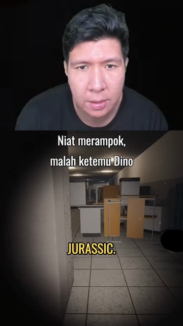
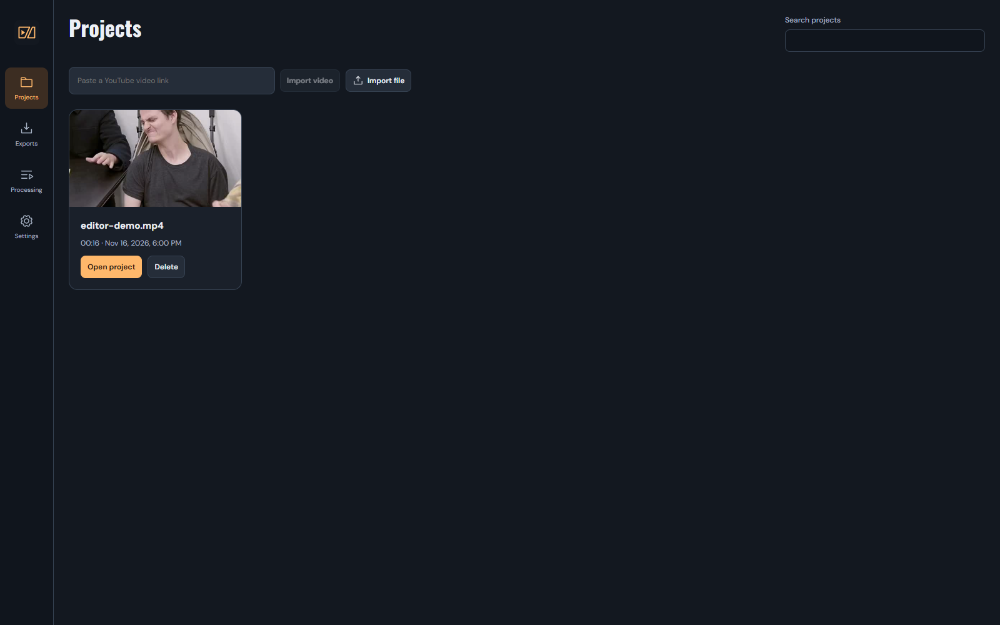

<div align="center">

# UnlimitedClipper

**Find the moment. Fix the captions. Keep the processing on your computer.**

A local video clipping studio built with Rust, React, SQLite, and Tauri.

[Clip examples](#clip-examples) · [Screenshots](#screenshots) · [Run locally](#run-locally) · [Docs](#documentation)

[Quality checks](https://github.com/bayurifkialghifari/unlimitedclipper/actions/workflows/ci.yml)

</div>

**Made for fun, still experimental.** This is a side project for tinkering with local video tools,
mostly for fun and learning, at a relaxed pace. Expect rough edges and changing features.


Import a long recording, find or choose a cut, review its words, and export a captioned video.
Speech recognition and clip selection run locally after the models are installed. No cloud AI
account or API key is required.

## Clip examples

Two actual exports from [Windah Basudara's Sunnybrook recording](https://www.youtube.com/watch?v=qTJIbYC2mFc).
Click a preview to open its MP4. Each example also includes a downloadable subtitle file.

<p align="center">
  <a href="docs/media/escape.mp4?raw=1">
    
  </a>
  <a href="docs/media/dinosaur.mp4?raw=1">
    
  </a>
</p>

- **Escape, 10.4 seconds:** [Watch MP4](docs/media/escape.mp4?raw=1) · [Subtitles](docs/media/escape.srt).
  A tight reaction cut with a red active-word box.
- **Dinosaur reaction, 8.7 seconds:** [Watch MP4](docs/media/dinosaur.mp4?raw=1) ·
  [Subtitles](docs/media/dinosaur.srt). Gameplay and facecam with bold yellow captions.

Both use local caption refinement, followed by manual word corrections and tighter cuts. They show
reviewed results rather than untouched automatic selections. README videos are smaller 720 × 1280
copies of the original 1080 × 1920 exports, with audio preserved.

## What you can do

| In the studio          | What it does                                                                                                     |
| ---------------------- | ---------------------------------------------------------------------------------------------------------------- |
| Bring your own footage | Import a local file or download a YouTube source with yt-dlp.                                                    |
| Find a moment          | Give local AI a focus and interest filter, or set the boundaries yourself. Clip count is a maximum, not a quota. |
| Make captions readable | Choose Studio, Impact, Word box, or Single word. Edit text, timing, typography, colors, and position.            |
| Check uncertain speech | Refine an individual cut with Whisper small or medium, then seek directly to words that need review.             |
| Frame the clip         | Use portrait, square, landscape, preserved framing, blur, or a gaming split. Adjust crops and keyframes.         |
| Finish the edit        | Add a hook title or image/text watermark, with revisioned autosave and undo/redo.                                |
| Export the result      | Render a single cut or a batch to MP4 with SRT and ASS sidecars. Retries keep completed exports.                 |

The desktop window and localhost browser use the same Rust engine and saved library. The interface
supports Indonesian and English. Video files stay in managed folders; SQLite stores project data
and edit revisions.

## Screenshots

### Caption editing

Four looks, the current clip's real words, and a preview of the active word. Styles, timing, and
manual corrections become part of the saved edit.


<details>
<summary>See the project library</summary>

Imported recordings and their edits persist locally. This screenshot shows the actual test
recording, with no invented projects or usage numbers.



</details>

## Run locally

The current tested setup is **Windows 11 ARM64**. Start with Node.js 24, Rust 1.92 or later, Git, and
a configured Windows C++ linker.

```powershell
git clone https://github.com/bayurifkialghifari/unlimitedclipper.git
cd unlimitedclipper
npm ci
npm run setup:tools
npm run dev
```

If a C++ linker is missing, run `npm run setup:compiler` before starting development. It prepares a
workspace-local LLVM toolchain without changing your global Rust default. Tool setup selects ARM64
or x64 for the Windows processor; see [setup](docs/setup.md) for explicit architecture selection.

Open **http://127.0.0.1:5173**. In Settings, install Whisper small and Qwen3 4B, then import a video.
Their combined initial download is about 2.69 GB. Whisper medium is optional. Manual clipping and
editing are available before installing the AI models.

To run the native desktop window instead:

```powershell
npm run dev:desktop
```

Local imports, editing, inference, and exports work offline after setup. YouTube downloads, model
downloads, and configured update checks use the internet. Development stores the library in `.data`;
installed applications use the OS application-data directory.

## Where it stands

Caption recognition still needs a human ear for slang, names, music, and shouting. Automatic moment
selection currently reads transcripts and can miss silent action or visual jokes. It may return
fewer clips than requested, or none. Review the footage before publishing.

| Platform                    | Current evidence                                                              |
| --------------------------- | ----------------------------------------------------------------------------- |
| Windows 11 ARM64            | Real native import, local inference, editing, recovery, and export checks.    |
| Windows x64                 | Source checks in CI; physical hardware and package certification pending.     |
| macOS Intel / Apple Silicon | Engine checks in CI; desktop packaging and runtime certification pending.     |
| Linux                       | Engine checks in CI; Debian/Arch packaging and runtime certification pending. |
| Android                     | ARM64 preview APK built; Android runtime untested.                            |
| Local browser               | Real Chromium upload, edit, reopen, and export workflows tested.              |

**Android preview:** [Download the debug-signed ARM64 APK](https://github.com/bayurifkialghifari/unlimitedclipper/actions/runs/43459222590/artifacts/14054984987)
(127.9 MiB). The build requires Android 10+ and 64-bit ARM. The initial target is Snapdragon 8+ Gen 1
with 12 GB RAM; RAM and storage budgets remain estimates. **Android runtime is untested.** This
media-only preview implements local-file import, manual editing, and export. Android AI, YouTube
imports, and automatic updates are disabled. Read the [requirements and limitations](docs/android.md)
before installing. GitHub retains this artifact for 30 days; the workflow can rebuild it afterward.

See [validation evidence](docs/validation.md) and [platform support](docs/platform-support.md) for the
scope of those checks. Production update signing and a current verified release installer remain
pending.

## For contributors

Useful bug reports include the source format, processor, reproduction steps, and relevant logs.
Small improvements and experiments are welcome. Read [AGENTS.md](AGENTS.md) before changing behavior.
Keep documentation and comments in English, and put interface text in the language dictionaries.

```powershell
npm run check
npm run test:rust
npm run test:e2e
```

Rust changes also require Rustfmt and Clippy. Test native behavior separately from browser behavior,
and record real processing evidence rather than assuming a build proves everything works.

<details>
<summary>How the code is organized</summary>

| Path            | Responsibility                                                            |
| --------------- | ------------------------------------------------------------------------- |
| `apps/studio`   | React editor using atoms, molecules, organisms, templates, and pages.     |
| `crates/engine` | Rust API, SQLite state, local inference, managed media, and durable jobs. |
| `apps/desktop`  | Tauri shell, native dialogs, window lifecycle, and application updates.   |
| `packages/ui`   | Shared interface primitives.                                              |
| `resources`     | Pinned tool, font, and model manifests.                                   |
| `scripts`       | Development, packaging, and real media validation.                        |

One heavy job runs at a time. Edits use revision checks, and every export captures an immutable saved
revision. The [architecture document](architecture.md) explains persistence, recovery, and tool
boundaries.

</details>

## Documentation

- **Using the app:** [Setup](docs/setup.md) · [Troubleshooting](docs/troubleshooting.md) ·
  [Feature guide](docs/features/README.md).
- **Building it:** [Product requirements](PRD.md) · [Architecture](architecture.md) ·
  [Design](DESIGN.md) · [Contributor rules](AGENTS.md).
- **Checking progress:** [Changelog](CHANGELOG.md) · [Validation](docs/validation.md) ·
  [Platform support](docs/platform-support.md) · [Release process](docs/release.md).
  [Android requirements and untested status](docs/android.md).
- **Sources:** [Research](docs/research.md) · [Demo media notes](docs/media/README.md) ·
  [Third-party notices](docs/third-party-notices.md).

The implementation is original. editorial reference and OpusClip are workflow references; their source,
branding, and marketing assets are not bundled.
